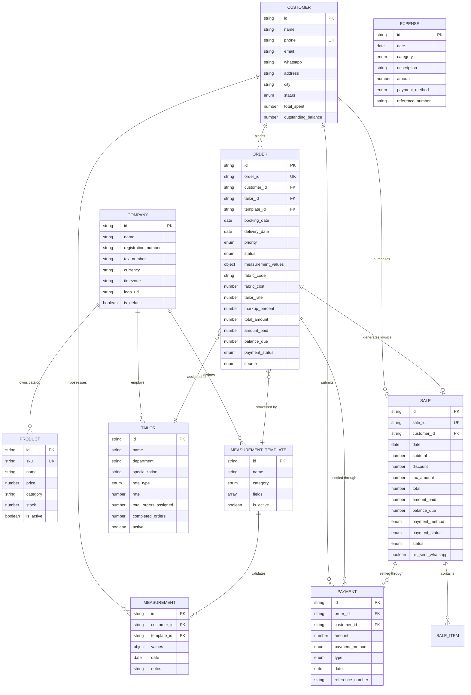

# THREDO — Database Architecture & Schema Specification
**Comprehensive Entity-Relationship Model, Schema Definitions & Storage Engine Details**

*Version 2.4.0 — Unified Edition*  
*Target Environments: Base44 Managed Cloud, Local Node.js, Vercel Serverless, AWS App Runner*

---

## 1. Database Architecture Overview

THREDO operates a hybrid database architecture optimized for high-throughput retail transactions, offline-resilient PDF generation, and real-time cloud synchronization:

1. **Primary Operational Datastore (Base44 Cloud Datastore):**
   - Manages all business entities (`Order`, `Sale`, `Customer`, `Measurement`, `MeasurementTemplate`, `Tailor`, `Payment`, `Expense`, `Product`, `Company`, `WebsiteConfig`).
   - Accessible via the typed client SDK [`src/api/base44Client.js`](file:///Users/ceooctapus/mehar/src/api/base44Client.js).
   - Schema enforcement via JSON Schema specifications in [`base44/entities/`](file:///Users/ceooctapus/mehar/base44/entities).
2. **Server-Side Paywall & Licensing Store (`paywall_db.json`):**
   - Atomic file-based JSON store located in `.data/paywall_db.json` (with automatic `/tmp/.data/` fallback for Vercel Serverless Functions and AWS Lambda).
   - Manages license tokens, 48-hour promotional coupon codes, payment intent sessions, and Ziina OIDC OAuth tokens.
3. **WhatsApp Dispatch & Audit Ledger (`invoice_send_records.json`):**
   - Tracks all WhatsApp invoice deliveries, Orbit API instance message IDs, delivery statuses, idempotency keys, and resend audits.
4. **Serverless Cache & In-Memory Fallback (`db.json`):**
   - Caches synchronized snapshots of sales, orders, and customer records so serverless PDF engines render and dispatch tax invoices with near-zero latency.

---

## 2. Entity-Relationship Diagram (ERD)



---

## 3. Schema Specifications by Entity

---

### 1. `Order` (Custom Tailoring Order Lifecycle)
*Schema File: [`base44/entities/Order.jsonc`](file:///Users/ceooctapus/mehar/base44/entities/Order.jsonc)*

Represents a bespoke made-to-measure tailoring order moving through the design, cutting, stitching, fitting, and delivery pipeline.

| Field Name | Type | Constraints / Enum | Default | Description |
| :--- | :--- | :--- | :--- | :--- |
| `id` | `string` | Auto-generated PK | — | Unique internal entity ID |
| `order_id` | `string` | Unique business code | — | User-facing order code (e.g. `ORD-100245`) |
| `customer_id` | `string` | **Required**, FK -> `Customer` | — | ID of ordering client |
| `customer_name`| `string` | **Required** | — | Name snapshot of ordering client |
| `tailor_id` | `string` | FK -> `Tailor` | — | Artisan assigned to stitch the garment |
| `tailor_name` | `string` | — | — | Name snapshot of assigned tailor |
| `booking_date` | `string (date)` | **Required** | Current date | Date the bespoke order was confirmed |
| `delivery_date`| `string (date)` | **Required** | — | Promised customer collection deadline |
| `priority` | `string` | `Normal`, `Rush`, `Premium` | `Normal` | Rush job status flag |
| `order_type` | `string` | `Standard`, `Alteration` | `Standard` | New bespoke garment vs. repair/alteration |
| `status` | `string` | `Booked`, `Cutting`, `Assigned`, `Stitching`, `Quality Check`, `Trial`, `Alteration`, `Ready`, `Delivered`, `Cancelled` | `Booked` | Current workshop stage |
| `template_id` | `string` | FK -> `MeasurementTemplate` | — | Measurement model used for sizing |
| `template_name`| `string` | — | — | Name of measurement profile |
| `measurement_values` | `object` | JSON Key-Value Map | `{}` | Anatomical parameters (e.g. `{ length: 58.5, chest: 42, sleeve: 24 }`) |
| `fabric_type` | `string` | — | — | Material description (e.g. *Japanese Toyobo Cotton*) |
| `fabric_code` | `string` | — | — | Swatch book SKU or roll code |
| `fabric_quantity` | `number` | Metric units (meters) | `0` | Meterage consumed |
| `fabric_cost` | `number` | Currency (AED) | `0` | Raw material cost of fabric |
| `supplier` | `string` | — | — | Fabric supplier or wholesaler name |
| `style_notes` | `string` | — | — | Collar, cuff, pocket, and placket styling instructions |
| `accessories` | `string` | — | — | Trims, buttons, zips, or thread details |
| `tailor_rate` | `number` | Currency (AED) | `0` | Stitching fee owed to the tailor |
| `markup_percent`| `number` | Percentage | `0` | Boutique markup percentage on base costs |
| `discount` | `number` | Number | `0` | Discount deduction |
| `discount_type`| `string` | `percent`, `fixed` | `percent` | Type of discount applied |
| `tax_percent` | `number` | Rate % | `0` (default 5% UAE VAT) | Applicable sales tax |
| `subtotal` | `number` | Currency (AED) | `0` | Billable subtotal before taxes |
| `total_amount` | `number` | Currency (AED) | `0` | Gross total payable by customer |
| `amount_paid` | `number` | Currency (AED) | `0` | Advance deposit collected |
| `balance_due` | `number` | Currency (AED) | `0` | Remaining uncollected balance |
| `payment_status`| `string` | `Paid`, `Partial`, `Pending` | `Pending` | Collection status |
| `payment_method`| `string` | Cash, Card, Ziina, Transfer | — | Advance payment tender mode |
| `delivery_method`| `string` | `Pickup`, `Delivery` | `Pickup` | Delivery mode |
| `source` | `string` | `manual`, `online` | `manual` | Origination source (POS vs Web Portal) |
| `online_pending`| `boolean` | Boolean | `false` | Awaiting admin review if submitted online |

---

### 2. `Sale` (Retail Point of Sale & Invoices)
*Schema File: [`base44/entities/Sale.jsonc`](file:///Users/ceooctapus/mehar/base44/entities/Sale.jsonc)*

Represents an itemized point-of-sale sales transaction, retail bill, or generated tax invoice.

| Field Name | Type | Constraints / Enum | Default | Description |
| :--- | :--- | :--- | :--- | :--- |
| `id` | `string` | Auto-generated PK | — | Unique internal sale entity ID |
| `sale_id` | `string` | **Required**, Unique | — | Formal Tax Invoice number (e.g. `INV-90214`) |
| `date` | `string (date)` | **Required** | Current date | Transaction timestamp |
| `customer_id` | `string` | FK -> `Customer` (Nullable) | — | Linked customer profile |
| `customer_name`| `string` | — | — | Customer display name |
| `customer_phone`| `string` | — | — | Customer phone for WhatsApp dispatch |
| `customer_email`| `string` | — | — | Customer email |
| `items` | `array<object>`| Array of line items | `[]` | Line items purchased (see structure below) |
| `subtotal` | `number` | Currency (AED) | `0` | Pre-tax sum of line items |
| `discount` | `number` | Currency (AED) | `0` | Total discount deducted |
| `tax_percent` | `number` | Percentage | `0` | VAT rate applied (typically 5%) |
| `tax_amount` | `number` | Currency (AED) | `0` | Computed VAT amount |
| `total` | `number` | Currency (AED) | `0` | Net payable transaction total |
| `amount_paid` | `number` | Currency (AED) | `0` | Tender received at register |
| `balance_due` | `number` | Currency (AED) | `0` | Unpaid balance (credit sales) |
| `payment_method`| `string` | `Cash`, `Card`, `UPI`, `Bank Transfer` | `Cash` | Primary payment tender |
| `payment_status`| `string` | `Paid`, `Partial`, `Pending` | `Pending` | Settlement state |
| `status` | `string` | `Completed`, `Refunded`, `Cancelled` | `Completed` | Sale status |
| `bill_sent_whatsapp`| `boolean` | Boolean | `false` | True if invoice was delivered via WhatsApp |
| `bill_sent_email`| `boolean` | Boolean | `false` | True if invoice was emailed |
| `source` | `string` | `manual`, `online` | `manual` | Originating channel |
| `online_pending`| `boolean` | Boolean | `false` | Flag for online orders |

#### Nested Line Item Structure (`items[]`)
```json
{
  "product_id": "prod_12345",
  "name": "Super 150s Italian Wool Fabric (3.5m)",
  "price": 450.00,
  "quantity": 1,
  "line_total": 450.00
}
```

---

### 3. `Customer` (Client CRM & Measurements Directory)
*Schema File: [`base44/entities/Customer.jsonc`](file:///Users/ceooctapus/mehar/base44/entities/Customer.jsonc)*

Maintains client contact records, measurement histories, lifetime spend, and receivables.

| Field Name | Type | Constraints / Enum | Default | Description |
| :--- | :--- | :--- | :--- | :--- |
| `id` | `string` | Auto-generated PK | — | Unique internal customer ID |
| `name` | `string` | **Required** | — | Client full legal/display name |
| `phone` | `string` | **Required** | — | Standardized international mobile number |
| `whatsapp` | `string` | International format | — | WhatsApp number if distinct from phone |
| `email` | `string` | Email format | — | Client email address |
| `address` | `string` | — | — | Street address / Villa / Apartment |
| `city` | `string` | — | — | City (e.g. Dubai, Abu Dhabi, Sharjah) |
| `area` | `string` | — | — | Neighborhood (e.g. Jumeirah, Al Barsha) |
| `postal_code` | `string` | — | — | Postal / Makani number |
| `status` | `string` | `active`, `inactive`, `blocked` | `active` | Account status |
| `notes` | `string` | Text | — | VIP tags, fabric preferences, fitting quirks |
| `total_orders` | `number` | Integer | `0` | Cumulative lifetime order count |
| `total_spent` | `number` | Currency (AED) | `0` | Cumulative lifetime revenue generated |
| `outstanding_balance`| `number` | Currency (AED) | `0` | Current unpaid receivables across all orders |

---

### 4. `Tailor` (Workshop Artisans & Piecework Compensation)
*Schema File: [`base44/entities/Tailor.jsonc`](file:///Users/ceooctapus/mehar/base44/entities/Tailor.jsonc)*

Tracks production staff, specialization categories, workload queues, and labor earnings.

| Field Name | Type | Constraints / Enum | Default | Description |
| :--- | :--- | :--- | :--- | :--- |
| `id` | `string` | Auto-generated PK | — | Artisan ID |
| `name` | `string` | **Required** | — | Tailor name |
| `department` | `string` | Text | `Workshop` | Assigned department (Workshop, Finishing) |
| `phone` | `string` | Mobile number | — | Contact telephone |
| `specialization`| `string` | Text | `General` | Expertise (Kandora, Suits, Trousers, Embroidery) |
| `rate_type` | `string` | `piecework`, `hourly` | `piecework` | Compensation structure |
| `rate` | `number` | Currency (AED) | `0` | Standard fee per completed garment |
| `active` | `boolean` | Boolean | `true` | Floor availability toggle |
| `total_orders_assigned`| `number`| Integer | `0` | All-time assigned order count |
| `completed_orders`| `number` | Integer | `0` | All-time successfully finished orders |
| `monthly_earnings`| `number`| Currency (AED) | `0` | Current month accrued piecework pay |

---

### 5. `MeasurementTemplate` & `Measurement` (Anatomical Sizing Model)
*Schema Files: [`base44/entities/MeasurementTemplate.jsonc`](file:///Users/ceooctapus/mehar/base44/entities/MeasurementTemplate.jsonc), [`base44/entities/Measurement.jsonc`](file:///Users/ceooctapus/mehar/base44/entities/Measurement.jsonc)*

Dynamic measurement engine allowing boutiques to define measurement profiles for any cultural or modern garment type.

#### `MeasurementTemplate` (Blueprint)
| Field Name | Type | Constraints / Enum | Description |
| :--- | :--- | :--- | :--- |
| `name` | `string` | **Required** | E.g. *Emirati Kandora*, *Classic 2-Piece Suit*, *Abaya* |
| `category` | `string` | `Men`, `Women`, `Kids`, `Unisex` | Target demographic |
| `fields` | `array<object>`| Dynamic fields array | List of anatomical parameters (Length, Chest, etc.) |
| `is_active` | `boolean` | `true` / `false` | Active in order creator |

#### Nested Template Field Definition (`fields[]`)
```json
{
  "field_name": "Chest Circumference",
  "unit": "cm",
  "default_value": "40",
  "is_required": true,
  "show_in_quick_view": true
}
```

#### `Measurement` (Recorded Client Profile)
| Field Name | Type | Description |
| :--- | :--- | :--- |
| `customer_id` | `string (FK)` | Target client |
| `template_id` | `string (FK)` | Template blueprint used |
| `values` | `object` | Map of measured values (e.g. `{"collar": "16.5", "shoulder": "18.0", "sleeve": "24.5"}`) |
| `date` | `string (date)`| Measurement recording date |
| `notes` | `string` | Posture and fit notes |

---

### 6. `Payment` (Financial Settlements & Audits)
*Schema File: [`base44/entities/Payment.jsonc`](file:///Users/ceooctapus/mehar/base44/entities/Payment.jsonc)*

Logs every incoming and outgoing monetary movement linked to sales or bespoke orders.

| Field Name | Type | Constraints / Enum | Default | Description |
| :--- | :--- | :--- | :--- | :--- |
| `order_id` | `string` | FK -> `Order` or `Sale` | — | Associated commercial transaction |
| `order_ref` | `string` | Human-readable code | — | Code (e.g. `INV-90214`, `ORD-10023`) |
| `customer_id` | `string` | FK -> `Customer` | — | Paying customer |
| `amount` | `number` | **Required** | — | Transaction monetary value (AED) |
| `payment_method`| `string`| `Cash`, `Card`, `UPI`, `Bank Transfer` | `Cash` | Tender used |
| `type` | `string` | `payment`, `advance`, `refund` | `payment` | Payment nature |
| `date` | `string (date)`| **Required** | Current date | Settlement timestamp |
| `reference_number`| `string`| External Reference | — | Card transaction auth code / Cheque # |
| `notes` | `string` | Text | — | Cashier settlement notes |

---

### 7. `Expense` (Operating Overheads & P&L)
*Schema File: [`base44/entities/Expense.jsonc`](file:///Users/ceooctapus/mehar/base44/entities/Expense.jsonc)*

Maintains business operating expenditures outside direct garment production.

| Field Name | Type | Constraints / Enum | Default | Description |
| :--- | :--- | :--- | :--- | :--- |
| `date` | `string (date)`| **Required** | Current date | Date expense incurred |
| `category` | `string` | `Fabric Purchase`, `Thread & Accessories`, `Salaries`, `Rent`, `Utilities`, `Equipment`, `Marketing`, `Transport`, `Other` | `Other` | Budget classification |
| `description` | `string` | Text | — | Purchase rationale |
| `amount` | `number` | **Required** | — | Amount paid (AED) |
| `payment_method`| `string`| `Cash`, `Card`, `UPI`, `Bank Transfer` | `Cash` | Account disbursed from |
| `reference_number`| `string`| Receipt / Invoice # | — | Vendor receipt reference |

---

### 8. `Product` (Retail Inventory Catalog)
*Schema File: [`base44/entities/Product.jsonc`](file:///Users/ceooctapus/mehar/base44/entities/Product.jsonc)*

| Field Name | Type | Constraints | Default | Description |
| :--- | :--- | :--- | :--- | :--- |
| `name` | `string` | **Required** | — | Retail item or fabric title |
| `sku` | `string` | Unique identifier | — | Barcode or internal SKU |
| `price` | `number` | **Required** | `0` | Retail sale price (AED) |
| `category` | `string` | Category | `General` | Retail grouping (Fabrics, RTW, Trims) |
| `stock` | `number` | Integer | `0` | Current on-hand inventory quantity |
| `is_active` | `boolean` | Boolean | `true` | Catalog visibility toggle |

---

### 9. `Company` (Enterprise Profile & Tax Registration)
*Schema File: [`base44/entities/Company.jsonc`](file:///Users/ceooctapus/mehar/base44/entities/Company.jsonc)*

| Field Name | Type | Description |
| :--- | :--- | :--- |
| `name` | `string` | **Required**, Trade name (e.g. *THREDO Tailoring Atelier*) |
| `legal_name` | `string` | Formal registered legal entity |
| `registration_number`| `string` | UAE Commercial Trade License Number |
| `tax_number` | `string` | UAE Federal Tax Authority (FTA) Tax Registration Number (TRN) |
| `currency` | `string` | ISO currency code (Default: `AED`) |
| `timezone` | `string` | Default: `Asia/Dubai` |
| `logo_url` | `string` | Hosted public URL of the atelier brand logo |
| `is_default` | `boolean` | Flag for multi-branch organizations (Default: `true`) |

---

## 4. Server-Side Datastore Specifications

Located in `.data/` (or `/tmp/.data/` on serverless execution environments):

### A. `paywall_db.json` (Licensing & OAuth Store)
```json
{
  "licenses": {
    "fQqpTK-PO41L_token_sample": {
      "plan": "coupon",
      "source": "coupon",
      "ref": "CD-UUFT-2GJZ",
      "createdAt": 1792015893000,
      "expiresAt": 1792188693000
    }
  },
  "coupons": {
    "CD-UUFT-2GJZ": {
      "createdAt": 1792015893000,
      "activatedAt": 1792016000000,
      "license": "fQqpTK-PO41L_token_sample",
      "note": "VIP Client Promo"
    }
  },
  "intents": {
    "pi_live_98124": {
      "plan": "lifetime",
      "amount": 320000,
      "createdAt": 1792015893000,
      "license": "token_lifetime_xyz"
    }
  },
  "oauth": {
    "ziina": {
      "accessToken": "eyJhbGciOi...",
      "refreshToken": "rt_89124...",
      "tokenType": "Bearer",
      "expiresAt": 1792055493000,
      "scope": "read_account write_payment_intents",
      "account": {
        "id": "acc_78129",
        "name": "Thredo Bespoke Couture",
        "currency": "AED"
      },
      "connectedAt": 1792015893000,
      "clientId": "test"
    }
  },
  "oauthStates": {
    "f988851ce28b471ac7f65af6b21b4e17": {
      "createdAt": 1792015893000,
      "redirectUri": "https://octapusthredoo.vercel.app/api/ziina/oauth/callback",
      "clientId": "test"
    }
  }
}
```

### B. `invoice_send_records.json` (WhatsApp Dispatch Ledger)
```json
[
  {
    "invoice_id": "INV-100234",
    "idempotency_key": "idemp-91283-abc",
    "preview_recipient": "971501234567",
    "status": "SENT",
    "orbit_message_id": "orb_msg_9812401",
    "timestamp": "2026-10-15T11:42:00.000Z",
    "caption": "Dear Alex, your Tax Invoice INV-100234 is ready.",
    "attempts": 1
  }
]
```

---

## 5. Security & Indexing Rules

1. **Phone Number Canonicalization:** Phone numbers are indexed without spaces, dashes, or punctuation and must pass `libphonenumber-js` parsing with an explicit country calling code (e.g. `971501234567`).
2. **Double-Spend & Duplicate Redemption Blocking:** Coupon redemption executes via atomic dictionary mutation (`c.activatedAt = now()`) inside single-threaded memory passes to prevent race conditions.
3. **Admin Key Protection:** Coupon creation, coupon listing, and OAuth disconnection require the `x-admin-key` HTTP header matching the server's `ADMIN_KEY` environment secret.
4. **Data Isolation:** Secrets and customer personally identifiable information (PII) are never logged to public endpoints or browser storage.
