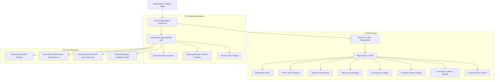
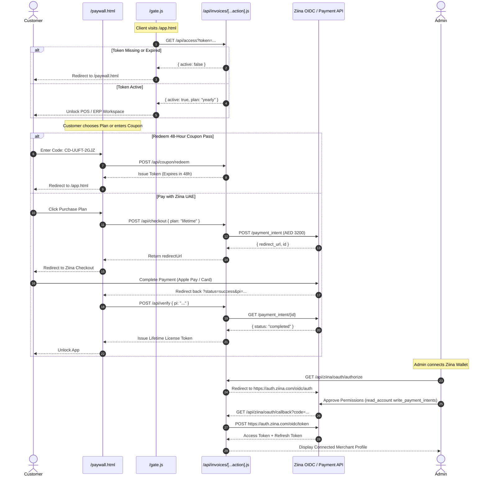

# THREDO — Master Software & Feature Documentation
**Tailoring Business ERP, Point of Sale (POS), WhatsApp Automation & Cost Desk Licensing System**

*Version 2.4.0 — Unified Edition*  
*Target Market: UAE, Saudi Arabia, GCC & Global Couture Boutiques*  
*Live Production Deployment: [https://octapusthredoo.vercel.app](https://octapusthredoo.vercel.app)*

---

## 1. Executive Summary & System Overview

**THREDO** is an enterprise-grade cloud Point of Sale (POS) and Enterprise Resource Planning (ERP) platform architected specifically for bespoke tailoring ateliers, fashion boutiques, traditional GCC garment makers (Kandora, Abaya, Jalabiya, Thobe), and retail fabric houses.

The platform eliminates physical order books, lost measurement sheets, and delayed customer communications by providing an interconnected ecosystem covering:

1. **Omnichannel Point of Sale (POS):** Fast barcode/search cashier terminal, custom discounts, UAE VAT (5%) compliance, multi-tender split payments, 80mm thermal receipts, and formal A4 PDF tax invoices.
2. **End-to-End Tailoring Workflow:** 6-step bespoke order builder, customizable anatomical measurement templates, fabric swatch tracking, tailor workshop job queueing, and fitting stage alerts.
3. **Automated WhatsApp Orbit Gateway:** Direct-to-customer invoice dispatch with attached PDF bills, payment links, delivery readiness notifications, and idempotency protection.
4. **Customer Relationship Management (CRM):** Customer measurement vault, re-order history, pending balance ledgers, and direct communication logs.
5. **Workshop & Tailor Operations:** Task allocation, stitching speed tracking, tailor piece rates, and commission payouts.
6. **Financial Accounting & Ledgers:** Income collection vs. operating expenses (rent, fabrics, tailor wages, utilities), receivables aging, and net profit calculations.
7. **Public Self-Service Ordering Portal:** Customer-facing web page for browsing fabrics or entering custom measurements from home.
8. **Cost Desk Paywall & UAE Ziina Gateway:** Built-in SaaS licensing gatekeeper (`/gate.js`), client-facing paywall (`/paywall.html`), 48-hour promotional coupon generation (`/admin.html`), and UAE Ziina Payment Intents with OpenID Connect (OIDC) OAuth 2.0 wallet integration.

---

## 2. Architecture & Tech Stack

### Core Technologies
- **Frontend:** React 18, Vite 6, Tailwind CSS, Radix UI primitives, Lucide Icons, Framer Motion, TanStack Query (React Query v5), Recharts.
- **Document Generation:** `jspdf` (vector-perfect bilingual A4 Tax Invoices and 80mm ESC/POS thermal bills), `html2canvas`.
- **Backend Runtimes:** Node.js 20+, Express, Vercel Serverless Functions (`api/invoices/[...action].js`), native Docker container (`server/server.js`).
- **Database & Sync:** Base44 Cloud Datastore + local atomic JSON fallback store (`paywall_db.json`) for serverless environments.
- **Telecom & WhatsApp:** WhatsApp Orbit API Gateway instance pairing with automated phone number internationalization (`libphonenumber-js`).
- **Payments:** Ziina UAE API v2 (Cards, Apple Pay, Google Pay) + Ziina OpenID Connect (OIDC) OAuth 2.0 authorization code flow.

---

## 3. Deep Feature Walkthrough by Module

---

### Module 1: Executive Dashboard & Analytics (`/`)

The Dashboard provides real-time business telemetry for salon owners, managers, and cashiers upon logging into the system.

#### Key Features & Metrics
- **Top-Level KPI Cards:**
  - **Total Revenue (AED):** Cumulative collections from direct POS sales, tailoring order advances, and balance payments.
  - **Active Orders:** Count of orders currently moving through the workshop (excluding Delivered/Cancelled).
  - **Pending Workshop Jobs:** Orders assigned to tailors that require cutting, stitching, or alteration.
  - **Deliveries Due Today:** Urgent badge notifying staff of client pick-ups scheduled within the next 24 hours.
  - **Outstanding Balance:** Total unpaid receivables across active clients.
- **Interactive Visualizations (Recharts):**
  - **Revenue Trend Area Chart:** Daily and weekly sales velocity over the past 30 days.
  - **Order Stage Distribution (Donut Chart):** Visual breakdown of items in `Cutting`, `Stitching`, `Trial`, `Ready`, and `Delivered`.
  - **Tailor Output (Bar Chart):** Completed units per tailor for performance monitoring.
- **Quick Action Bar:**
  - One-click launcher for `New Order`, `New Sale (POS)`, `Quick Order Search`, `Record Payment`, `Add Customer`, and `Settings`.
- **Company Setup Banner:** Prompts new installations to configure TRN (Tax Registration Number), business name, and currency before generating invoices.

---

### Module 2: Point of Sale (POS) & Fast Checkout (`/sales`)

A modern, high-throughput retail register optimized for both touchscreens (iPads/tablets) and desktop barcode scanners.

#### 1. Catalog & Cart Management
- **Instant Product Search:** Live filtering across Ready-Made Garments, Unstitched Fabrics, Accessories, Alterations, and Custom Services.
- **Category Filter Pills:** Switch instantly between `Fabrics`, `Ready to Wear`, `Accessories`, `Alterations`, and `Custom Stitching`.
- **Quick Item Creation Modal:** Cashiers can add an unlisted product or ad-hoc custom fee directly from the register without leaving the checkout page.
- **Cart Actions:** Adjust item quantities, change prices on the fly, apply per-line item notes, and delete items with one click.

#### 2. Pricing, Taxes & Discounts
- **UAE VAT (5%) Calculation:** Automated tax calculation compliant with the UAE Federal Tax Authority (FTA). Displays subtotal, VAT amount, and grand total.
- **Flexible Discounts:** Cashiers can apply a fixed AED amount or a percentage discount across the total cart.
- **Split & Partial Payments:** Supports partial deposits at booking with remaining balances flagged as `Balance Due` on the receipt.
- **Supported Payment Tenders:** Cash, Credit/Debit Card, Bank Transfer, Ziina Digital Wallet, and In-Store POS Terminal.

#### 3. Invoice & Receipt Generation
- **A4 Formal Tax Invoice (PDF):** Full bilingual layout with business header, TRN number, buyer details, itemized table with VAT breakdown, QR code verification, and authorized signature block.
- **80mm Thermal Receipt:** Compact layout for standard thermal printers (Epson, Star Micronics, Sunmi POS) with transaction ID, cashier name, item list, and return policies.
- **Direct PDF Download:** Generates client-side PDF downloads in under 200ms using vector rendering.

#### 4. Automated WhatsApp Receipt Delivery
- **Country Code Selector:** Automatic prefix detection for UAE (`+971`), Saudi Arabia (`+966`), Qatar (`+974`), Kuwait (`+965`), Oman (`+968`), Bahrain (`+973`), India (`+91`), UK (`+44`), and 10+ countries.
- **Personalized Message Template:** Formats a friendly message: *"Dear [Customer], thank you for visiting [Boutique]. Your tax invoice #[Number] for AED [Amount] is ready. Download your receipt here..."*
- **Auto-Attachment:** Invoices are automatically uploaded and linked inside the customer's WhatsApp chat.
- **Idempotency & Resend Safeguards:** Prevents accidental double-messaging through server-enforced unique idempotency keys.
- **Batch WhatsApp Dispatch:** Multi-select past invoices to send payment reminders or receipts in bulk.

---

### Module 3: Bespoke Tailoring Order Lifecycle (`/orders`, `/orders/new`, `/orders/:id`)

The core engine for handling custom made-to-measure tailoring.

#### 6-Step Order Builder Wizard (`/orders/new`)
1. **Step 1: Customer Identification:**
   - Search existing customer database by mobile number or name.
   - Or click *New Customer* to register client profile and proceed seamlessly.
2. **Step 2: Order Specifications:**
   - Set Booking Date and Promised Delivery Date.
   - Priority Flagging: `Normal`, `Urgent` (24-48h rush), or `Express`.
   - Order Type: `Standard Bespoke`, `Alteration Only`, or `Bulk Uniforms`.
3. **Step 3: Anatomical Measurements:**
   - Select Measurement Template (e.g. *Emirati Kandora*, *Kuwaiti Dishdasha*, *Classic 2-Piece Suit*, *Abaya*, *Trousers*, *Blazer*).
   - System pre-fills previous customer measurements if on file.
   - Enter all anatomical parameters in Centimeters or Inches.
4. **Step 4: Fabric, Styling & Workshop Allocation:**
   - Record Fabric Code, Fabric Name, Meterage, and Fabric Cost.
   - Specify styling choices: Collar style (Traditional, Mandarin, Shirt Collar), Cuffs (French, Single button), Pocket layout, Front placket buttons, and Embroidery pattern.
   - Assign to a specific tailor in the workshop and define the tailor's stitching rate (cost of labor).
5. **Step 5: Financial Calculation & Deposit:**
   - Real-time costing: `(Fabric Cost + Tailor Rate) * Markup % + Additional Services`.
   - Apply promotional discount (Fixed AED or %).
   - Add VAT (5%).
   - Record advance deposit (e.g., 50% deposit, 100% full payment, or cash on delivery).
6. **Step 6: Review & Finalize:**
   - Comprehensive summary sheet displaying customer, measurements, styling notes, workshop assignees, and financial terms.
   - One-click order submission: Automatically prints job card, saves measurement history to client profile, creates invoice, and schedules workshop due date.

#### 10-Stage Workshop Pipeline (`/orders/:id`)
Orders transition through visual status badges:
1. `Booked` — Order logged, fabric in stock.
2. `Cutting` — Fabric master cutting pattern pieces according to measurements.
3. `Assigned` — Cut pieces handed to designated tailor.
4. `Stitching` — Garment under assembly in workshop.
5. `Quality Check` — Master tailor inspecting seams, buttonholes, and dimensions.
6. `Trial` — Garment ready for client first-fitting trial.
7. `Alteration` — Adjustments logged following client fitting.
8. `Ready` — Ironed, bagged, and ready for pick-up/dispatch.
9. `Delivered` — Handed to customer; final balance collected.
10. `Cancelled` — Order voided with refund logged in accounts.

---

### Module 4: Measurement Vault & Customer CRM (`/customers`, `/customers/:id`)

#### Customer Database (`/customers`)
- **Centralized Directory:** Searchable by name, mobile number, email, or physical address.
- **Customer KPI Tags:** Displays total lifetime spend, active orders in progress, and outstanding receivables per customer.
- **One-Click Actions:** Start New Order, Initiate WhatsApp Chat, or View Measurement Card.

#### Customer Detail Profile (`/customers/:id`)
- **Measurement Card Archive:** Preserves complete measurement histories over time. Tailors can inspect changes between years (e.g., collar adjustments, length changes).
- **Order History Ledger:** Full chronological record of every garment made, fabrics chosen, and tailor notes.
- **Billing & Payment Balance:** Live view of total invoiced, total paid, and pending balance.

---

### Module 5: Workshop & Tailor Management (`/tailors`)

Empowers managers to run a productive, transparent cutting and stitching floor.

- **Tailor Profiles:** Name, mobile number, specialty (e.g. *Kandora Specialist*, *Suit Master*, *Embroidery Artisan*, *Trouser Maker*), and active status toggle.
- **Live Workload Tracking:** Shows total jobs assigned, currently open stitching tasks, and completion percentage.
- **Piece-Rate / Labor Costing:** Tracks accrued tailor compensation per garment stitched to calculate fair, transparent weekly/monthly tailor payouts.

---

### Module 6: Accounts, Expenses & Financial Ledgers (`/accounts`, `/payments`)

A double-entry financial management system tailored to retail manufacturing.

#### Accounting Overview (`/accounts`)
- **Total Inflow (Revenue):** Real-time aggregation of retail POS cash/card receipts and bespoke order advances.
- **Direct Production Costs:** Sum of tailor stitching fees and fabric raw material costs.
- **Operating Expenses:** Tracks overhead categories:
  - *Shop Rent & Utilities*
  - *Staff Salaries & Advances*
  - *Sewing Machine Maintenance & Needles*
  - *Threads, Buttons, Zippers & Trims*
  - *Marketing & Packaging Supplies*
- **Net Operating Margin:** Automatically computes `Total Revenue - Direct Costs - Operating Overheads`.
- **Receivables Ledger:** Real-time breakdown of money owed by clients with promised pick-up dates.

#### Payment Records (`/payments`)
- Filter and audit every financial transaction by payment mode (Cash, Card, Ziina, POS, Bank Transfer).
- Log partial balance settlements when clients collect garments.
- Process and track refunds against cancelled orders with audit reasons.
- Export accounting report to PDF.

---

### Module 7: Public Online Ordering Portal (`/order-online`, `/online-orders`)

Enables boutique clients to place orders from their home, hotel, or office without visiting the shop in person.

#### Customer Experience (`/order-online`)
- **Dual Mode Ordering:**
  1. **Custom Tailoring:** Client selects garment type, enters their body measurements (guided by measurement illustrations), selects fabric preferences, and chooses preferred delivery date.
  2. **Retail Catalog:** Client browses ready-made garments, fabrics, and accessories, sets quantities, and adds items to their shopping cart.
- **Delivery Preferences:** In-store pick-up or home courier delivery with address details.
- **Mobile Friendly:** 100% responsive interface designed for smartphones.

#### Admin Ingestion Queue (`/online-orders`)
- Incoming customer submissions appear in a dedicated review queue.
- Store managers review measurements and pricing, contact the customer via WhatsApp to confirm details, and convert the online request into a live workshop order with 1 click.

---

### Module 8: Settings, Branding & Localization (`/settings`)

Full customization of your atelier's visual identity, tax rules, and system behavior.

1. **Company Profile:** Business legal name, trade license number, VAT TRN, phone, email, and branch addresses.
2. **Products & Inventory:** Product SKU manager, retail prices, cost prices, and stock quantity tracking.
3. **Measurement Templates:** Create or edit templates for any garment type worldwide. Add custom measurement fields (e.g. *Knee-to-ankle*, *Wrist circumference*, *Cross-back*).
4. **Payment Channels:** Enable/disable tender options shown in the POS.
5. **Branding & Print Formatting:** Upload high-resolution boutique logo, configure primary color palette, and define invoice disclaimers in English and Arabic.
6. **Online Store Controls:** Enable or disable public web ordering and configure welcome banners.

---

## 4. Cost Desk Licensing, Paywall & UAE Ziina Gateway

The application includes an autonomous commercial licensing and payment suite located in `public/` and `server/paywallBackend.js`.

### 1. Cost Desk Paywall (`/paywall.html`)
- Displays modern glassmorphism pricing cards:
  - **Yearly Plan:** AED 2,222 / year (includes all updates and support).
  - **Lifetime Plan:** AED 3,200 one-time payment.
  - **List Price Reference:** AED 6,000 (displays promotional savings).
- **Instant Coupon Pass Box:** Prospects enter a promotional 48-hour access code to evaluate the full POS immediately.
- **Instant Activation:** Automatically stores license tokens in client storage and redirects straight into the POS application.

### 2. Coupon Admin Console (`/admin.html`)
- Accessible only with the secure `ADMIN_KEY` (default: `admin12345`).
- **Batch Generator:** Generate 1 to 100 single-use codes formatted as `CD-XXXX-XXXX` with optional campaign/client tags.
- **Analytics & Status Ledger:** Real-time metrics for *Total Generated*, *Unused Passes*, *Active Passes (inside 48h)*, and *Expired Passes*.
- **Quick Share Tools:** One-click copy, batch text export, and direct pre-filled URLs (`https://octapusthredoo.vercel.app/paywall.html?code=CD-XXXX-XXXX`).

### 3. Ziina UAE Payment Gateway & OIDC OAuth 2.0
- **Supported Payment Methods:** UAE Debit/Credit cards, Apple Pay, Google Pay, and AMEX in AED.
- **OAuth 2.0 / OIDC Flow:**
  - Authorize URL: `https://auth.ziina.com/oidc/auth?client_id=...&response_type=code&redirect_uri=...&scope=read_account+write_payment_intents&state=...`
  - Token Exchange: `POST https://auth.ziina.com/oidc/token`
  - Profile Fetch: `GET https://api-v2.ziina.com/api/account`
- **Dynamic Payouts:** Automatically uses the authenticated merchant wallet token for all payment intents, depositing customer funds directly into the merchant's UAE bank account.
- **Safe Fallback:** Automatically falls back to static `ZIINA_API_KEY` if OAuth has not yet been linked.

---

## 5. Security & Gatekeeping Architecture (`/gate.js`)

To ensure only paid or trial-licensed users access proprietary business data:

1. **Lightweight Guard:** Include `` in the `<head>` of protected pages.
2. **Fast Token Verification:** Reads local token, contacts `/api/access?token=...`, and caches verification for 60 seconds to prevent unnecessary network requests.
3. **Graceful Redirect:** Redirects unlicensed users to `/paywall.html?reason=unlicensed` with a return parameter preserving their destination.

---

## 6. Multi-Platform Deployment & Server Execution

The codebase supports three deployment models:

### 1. Vercel Serverless (Current Production)
- Catch-all serverless router at [`api/invoices/[...action].js`](file:///Users/ceooctapus/mehar/api/invoices/[...action].js).
- Handled with [`vercel.json`](file:///Users/ceooctapus/mehar/vercel.json) rewrites: all `/api/(.*)` routed to `/api`, and non-static assets routed to `/index.html`.
- Production URL: `https://octapusthredoo.vercel.app`.

### 2. AWS App Runner / ECS / Docker
- Fully containerized Node.js 20 service using [`Dockerfile`](file:///Users/ceooctapus/mehar/Dockerfile) and [`apprunner.yaml`](file:///Users/ceooctapus/mehar/apprunner.yaml).
- Production entry point: `server/server.js` listening on port `3000` (or `PORT`).
- Built-in `/health` and `/api/health` endpoints returning JSON health status.

### 3. Local Development (Vite + Base44)
- Run `npm run dev` or `base44 dev`.
- Protected endpoints, WhatsApp dispatch, and Paywall APIs run inside [`server/whatsappVitePlugin.js`](file:///Users/ceooctapus/mehar/server/whatsappVitePlugin.js) without needing an external Express server.

---

## 7. Environment Variables Reference

| Variable | Description | Default / Example |
| :--- | :--- | :--- |
| `ORBIT_API_URL` | Base URL of WhatsApp Orbit Gateway | `https://orbit-35-154-242-129.sslip.io` |
| `ORBIT_INSTANCE_TOKEN` | Secret token for Orbit WhatsApp instance | `6F6247B88F41-4C6A-A5A8...` |
| `ORBIT_INSTANCE_ID` | UUID identifier of WhatsApp instance | `7ec5dd02-6a7f-41a9...` |
| `ORBIT_SENDER_NUMBER`| Registered WhatsApp dispatch telephone | `+971500000000` |
| `ZIINA_API_KEY` | Static Ziina Merchant API key | `R4CBZI3tATCvc3qF0ZRP...` |
| `ZIINA_TEST` | Set `false` for live AED charges; `true` for sandbox | `true` |
| `ZIINA_CLIENT_ID` | Ziina OIDC Application Client ID | `test` |
| `ZIINA_CLIENT_SECRET`| Ziina OIDC Application Client Secret | *(Optional/Provisioned)* |
| `ZIINA_REDIRECT_URI` | Registered OAuth callback URL | `https://octapusthredoo.vercel.app/api/ziina/oauth/callback` |
| `ADMIN_KEY` | Passphrase to access Coupon Admin Console | `admin12345` |
| `PUBLIC_URL` | Root URL of deployed web service | `https://octapusthredoo.vercel.app` |
| `APP_URL` | Destination URL unlocked by paywall | `/app.html` or `/` |

---

## 8. Summary of All Accessible Application URLs

| Path | Purpose & Target User |
| :--- | :--- |
| [`/`](https://octapusthredoo.vercel.app/) | Executive Analytics Dashboard & Main POS Workspace |
| [`/sales`](https://octapusthredoo.vercel.app/sales) | Retail POS Cashier Register, Invoicing & WhatsApp Sender |
| [`/orders`](https://octapusthredoo.vercel.app/orders) | Tailoring Order Ledger & Workshop Pipeline |
| [`/orders/new`](https://octapusthredoo.vercel.app/orders/new) | 6-Step Custom Garment Order Wizard & Measurement Input |
| [`/customers`](https://octapusthredoo.vercel.app/customers) | Customer CRM & Contact Directory |
| [`/tailors`](https://octapusthredoo.vercel.app/tailors) | Workshop Floor, Tailor Assignment & Labor Piece Rates |
| [`/accounts`](https://octapusthredoo.vercel.app/accounts) | Accounting, Expense Logs, Receivables & Profit Analysis |
| [`/payments`](https://octapusthredoo.vercel.app/payments) | Payment Audit Records, Balance Clearances & Refunds |
| [`/order-online`](https://octapusthredoo.vercel.app/order-online) | Public Customer Self-Service Ordering Portal |
| [`/online-orders`](https://octapusthredoo.vercel.app/online-orders) | Ingestion Queue for Online Customer Submissions |
| [`/settings`](https://octapusthredoo.vercel.app/settings) | Atelier Branding, TRN VAT Settings & Templates |
| [`/paywall.html`](https://octapusthredoo.vercel.app/paywall.html) | Customer Licensing Paywall & Coupon Redemption |
| [`/admin.html`](https://octapusthredoo.vercel.app/admin.html) | Coupon Administration & Ziina OAuth Connection Console |
| [`/app.html`](https://octapusthredoo.vercel.app/app.html) | Gated Workspace Demonstration Shell |
